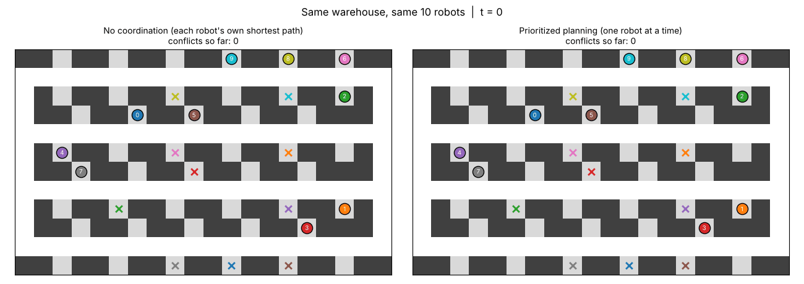
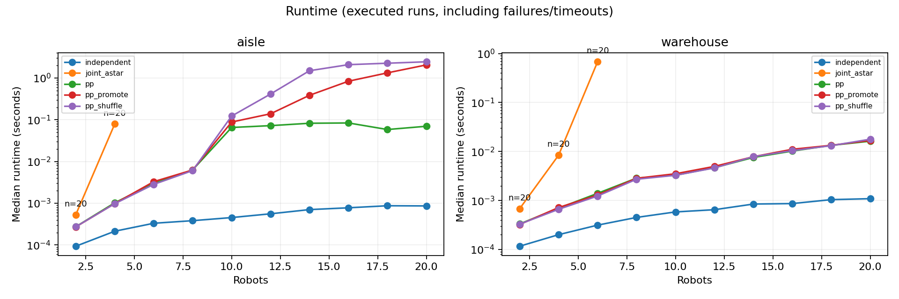
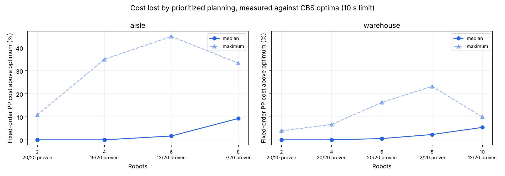
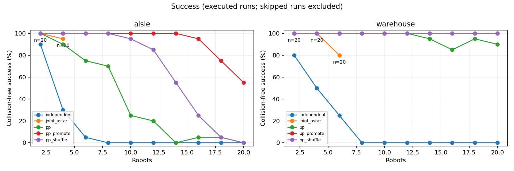
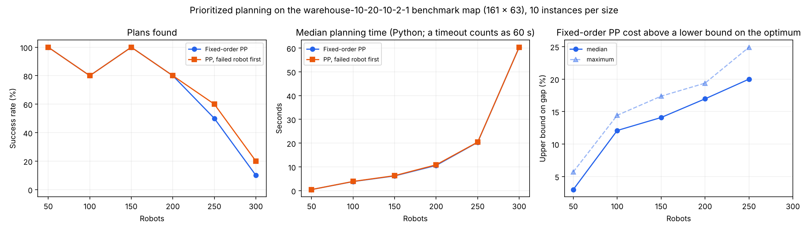

# Why Warehouse Robots Don't Plan Optimally

**DCSS309 Algorithms · Korea University Sejong · Group A4**

In a robotic fulfilment centre, many robots share the same narrow aisles, and every one of them needs a path that never collides with another. An optimal planner can find the cheapest set of paths, but its search grows exponentially with the number of robots. This project measures that trade-off on a small warehouse grid, repeats the prioritized-planning part on a standard benchmark warehouse map with up to 300 robots, and asks why companies use a fast, non-optimal method, *prioritized planning*, instead.



*Same warehouse, same 10 robots. Left: every robot takes its own shortest path and collisions pile up (red circles). Right: prioritized planning, no collisions.*

## Summary

In our experiment, the optimal planner (Joint A*) first ran out of its 10-second limit at **4 robots** on an open-aisle layout and at **6 robots** on a warehouse layout. Prioritized planning (PP) answered within a fraction of a second at every size up to 20 robots, and on the warehouse layout it found a plan for 18 of 20 instances even at 20 robots. PP has two weaknesses: it can fail to find a plan, and its plans can cost more than the optimum. Failures were rare when goals sat in side bays off the aisles, but frequent when they sat in the aisles themselves. Planning the failed robot first rescued most failures.

On a standard benchmark warehouse map about 40 times larger, fixed-order PP found plans for 8 of 10 instances with 200 robots, in a median of about 10 seconds even in plain Python, and the median cost of those plans was at most 17% above the optimum. Failures became frequent at 250 robots (5 of 10 solved) and 300 (1 of 10). Every timeout came from robots parked in aisles cutting off a later robot.

This supports the project's working conclusion:

> **Use fast prioritized planning instead of optimal search, and cover its weaknesses with warehouse design and by changing the planning order.**

## Team

| Member | Responsibility |
| --- | --- |
| 유현석 | Project lead; algorithm review, independent verification and explanation |
| LIU Zhenyi | Implementation, experiments and demo animation |
| 정고은 | Company case analysis, results analysis, recorded video |

Presentation: 정고은 and 유현석.

## The problem

Robots move on a grid. At each time step a robot moves one cell up, down, left or right, or waits. A plan is legal only if

- no two robots are in the same cell at the same time (*vertex conflict*), and
- no two robots swap cells in one step (*swap conflict*).

A robot that has finished parks on its goal and keeps occupying it. The cost of a plan is the **sum of the times at which robots reach their goals for the last time**. This problem is called multi-agent path finding (MAPF).

## Methods compared

| Method | Idea | Optimal? |
| --- | --- | --- |
| Independent BFS | Each robot takes its own shortest path and ignores the others | No, and usually collides (baseline only) |
| Joint A* | A* over the combined positions of all robots | Yes |
| Prioritized planning (PP) | Plan robots one at a time with space-time A*; later robots avoid the paths already reserved | No |
| PP, failed robot first | When a robot cannot be planned, move it to the front and replan everyone | No |
| PP, random shuffle | When a robot cannot be planned, shuffle the order and replan | No |

An independent **conflict-based search (CBS)** solver was also written for verification and used to prove optima beyond the reach of Joint A*.

## Experiment

- 12 × 20 grid with one-cell-wide aisles and 45 recessed station bays.
- Two layouts:
  - **Aisle**: starts and goals are random aisle cells, so a parked robot can block a corridor.
  - **Warehouse**: starts and goals are station bays off the aisles.
- 2 to 20 robots (even numbers), 20 instances per size and layout: 400 instances × 5 methods = 2,000 result rows. Joint A* is not run at sizes above its first timeout (300 rows marked as skipped), so 1,700 runs were executed.
- 10-second limit per run. Fixed seed (20261029), so the instances are identical on every run. A full re-run on a second machine gave the same result for every row; only the runtimes differed.

## Results

### 1. Optimal search runs out of time after a handful of robots



| Layout | Joint A*: first size with a timeout | Joint A* median time at that size | Fixed-order PP at 20 robots: median time, plans found |
| --- | --- | --- | --- |
| Aisle | 4 robots (1 of 20 timed out) | 0.079 s | 0.070 s, 0 of 20 |
| Warehouse | 6 robots (4 of 20 timed out) | 0.68 s | 0.016 s, 18 of 20 |

Medians include timed-out and failed runs. After the first timeout, larger sizes are skipped for Joint A*, so the experiment does not measure how much longer it would take beyond that point. On the aisle layout PP is fast but often fails; section 3 covers that.

With k robots, Joint A* must consider up to 5^k combined moves at every step (each robot moves in one of four directions or waits), so each extra robot multiplies the work. PP searches for one robot at a time, so adding a robot adds one more search instead.

### 2. PP gives up some cost, and more as the floor gets busier



Gap = how much higher PP's total cost is than the proven optimum. With CBS, we proved optima for 149 instances (Joint A* alone: 95). A gap can only be measured where PP also found a plan, so the number of gaps can be smaller than the number of proven optima.

| Layout | Robots | Proven optima | Gaps measured | Fixed-order PP median gap | Maximum gap |
| --- | --- | --- | --- | --- | --- |
| Warehouse | 2 | 20/20 | 20 | 0% | 3.9% |
| Warehouse | 4 | 20/20 | 20 | 0% | 6.7% |
| Warehouse | 6 | 20/20 | 20 | 0.5% | 16.3% |
| Warehouse | 8 | 12/20 | 12 | 2.3% | 23.2% |
| Warehouse | 10 | 12/20 | 12 | 5.4% | 10.0% |
| Aisle | 2 | 20/20 | 20 | 0% | 10.8% |
| Aisle | 4 | 19/20 | 17 | 0% | 35.0% |
| Aisle | 6 | 13/20 | 12 | 1.7% | 44.9% |
| Aisle | 8 | 7/20 | 7 | 9.3% | 33.3% |

For small fleets PP is usually optimal or close to it, but the typical gap grows with the number of robots and single instances can be far worse. **Caveat:** at larger sizes CBS only finishes the easier instances, so these gaps are probably *underestimates* there. Sizes with fewer than 5 proven optima are left out of the plot. Full data: [`analysis/cbs_gap.csv`](analysis/cbs_gap.csv).

### 3. PP succeeds far more often when goals are in side bays



| Layout | Fixed-order PP success |
| --- | --- |
| Aisle | 78 / 200 (39.0%) |
| Warehouse | 193 / 200 (96.5%) |

On the aisle layout, fixed-order PP found a plan for at most 5 of 20 instances at every size from 10 robots up. A likely reason: when goals are in side bays, a parked robot does not block a corridor that later robots need. The two layouts differ in more than this one factor, so the comparison shows a strong association, not a proof of cause.

### 4. Changing the planning order rescues most failures

| Layout | Fixed order | Failed robot first | Random shuffle |
| --- | --- | --- | --- |
| Aisle | 78 / 200 | 185 / 200 | 133 / 200 |
| Warehouse | 193 / 200 | 200 / 200 | 200 / 200 |

Fixed-order PP failed on 129 instances. Moving the failed robot to the front solved 114 of them; random shuffling solved 62. Neither variant failed on an instance that fixed-order PP solved. Reordering does not fix everything: on the aisle layout with 20 robots, the failed-robot-first variant still failed on 9 of 20 instances, and its median time rose to 2.1 s because of repeated replanning. In a separate study with five orders per instance, the order changed whether planning succeeded on 90 of 400 instances and changed the cost on 222.

### 5. At benchmark scale: 50 to 300 robots on a real-size warehouse map



We repeated PP on `warehouse-10-20-10-2-1` from the MovingAI MAPF benchmark (161 × 63 cells, 5,699 free cells), with random starts and goals and 10 instances per size. The optimum cannot be computed at this size, so PP's cost is compared with a lower bound (the sum of each robot's own shortest-path length); the result is an upper bound on the real gap.

| Robots | Collisions without coordination (median) | Fixed-order PP: plans found | Fixed-order PP: median time of successful runs | Cost above lower bound: median |
| ---: | ---: | ---: | ---: | ---: |
| 50 | 32 | 10/10 | 0.4 s | 3.0% |
| 100 | 127 | 8/10 | 3.3 s | 12.1% |
| 150 | 359 | 10/10 | 6.2 s | 14.1% |
| 200 | 702.5 | 8/10 | 10.4 s | 17.0% |
| 250 | 1,105.5 | 5/10 | 16.5 s | 20.0% |
| 300 | 1,418.5 | 1/10 | 29.1 s | (1 run) |

- PP still plans hundreds of robots in seconds to tens of seconds, in Python. The upper bound on its cost gap grows with crowding (the bound itself probably loosens as robots crowd).
- Fixed-order PP failed 18 times (14 timeouts, 4 `blocked`). In all 14 timeouts, the robot being planned was cut off from its goal by robots parked before it, the same mechanism as the aisle layout above. Failed-robot-first rescued only 2 runs: after a timeout there was no time left to try another order.
- To make this size feasible, PP was re-implemented with hash-table reservations ([`scale/fast_pp.py`](scale/fast_pp.py)). It returns exactly the same paths as `mapf.py` on all 1,200 PP runs of the main experiment and on 12 runs on the benchmark map.

Details, limits and how to run: [`scale/README.md`](scale/README.md).

## Verification

The experiment code was checked by separately written code (see [`verification/README.md`](verification/README.md)):

- **Full re-run on a second machine:** all 2,000 rows have the same success values and costs; only runtimes differ ([comparison](verification/results/rerun_comparison.txt)).
- **Independent validator:** all 1,484 returned plans re-checked, no mismatch.
- **Independent CBS:** all 95 Joint A* optima reproduced exactly; PP was never below an optimum.
- **Stress test:** 400 random instances on small crowded grids, no disagreement.

## Repository layout

| Path | Contents |
| --- | --- |
| `mapf.py` | Grid, BFS, space-time A*, Joint A*, PP and its reordering variants, validator |
| `run_project.py`, `run.py`, `order_study.py`, `report.py` | Experiment pipeline |
| `outputs/` | Results of the main run (CSV, saved paths, plots, `EXPERIMENT_REPORT.md`) |
| `analysis/` | Cost gap against CBS optima |
| `presentation/` | Side-by-side animation for the talk |
| `scale/` | PP on a standard benchmark warehouse map, 50 to 300 robots |
| `verification/` | Independent checks and the reference CBS |
| `tests/` | Unit and pipeline tests |
| [`docs/TECHNICAL.md`](docs/TECHNICAL.md) | Full technical documentation: data format, method details, metrics |

## How to run

Python 3.10 or later.

```bash
python -m pip install -r requirements.txt
python run_project.py                 # tests + main experiment + order study (several minutes)
python analysis/cbs_gap.py            # CBS optima and cost-gap plot (slow: runs CBS on every instance)
python presentation/side_by_side.py   # side-by-side GIF
python scale/run_scale.py             # benchmark-map experiment (about 1 hour)
```

Quick check: `python run.py --quick --output quick_outputs`.

## AI usage

The experiment package was written with the help of ChatGPT/Codex ([`AI_USAGE.md`](AI_USAGE.md)). The verification code, the CBS analysis, the side-by-side animation and the benchmark-scale experiment were written with the help of Claude. All numbers in this README come from actual runs saved in this repository.

## References

- Silver (2005), *Cooperative Pathfinding*.
- Standley (2010), *Finding Optimal Solutions to Cooperative Pathfinding Problems*.
- Sharon et al. (2015), *Conflict-Based Search for Optimal Multi-Agent Pathfinding*.
- Stern et al. (2019), *Multi-Agent Pathfinding: Definitions, Variants, and Benchmarks* (source of the benchmark map).
- Bennewitz, Burgard & Thrun (2002), *Finding and Optimizing Solvable Priority Schemes for Decoupled Path Planning Techniques for Teams of Mobile Robots*.
- Čáp et al. (2015), *Prioritized Planning Algorithms for Trajectory Coordination of Multiple Mobile Robots*.

This is a small-scale educational study of published principles. It does not reproduce any company's maps, code or fleet sizes.
