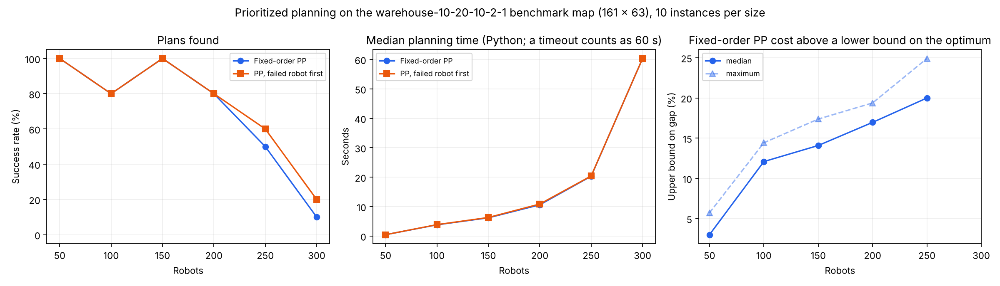
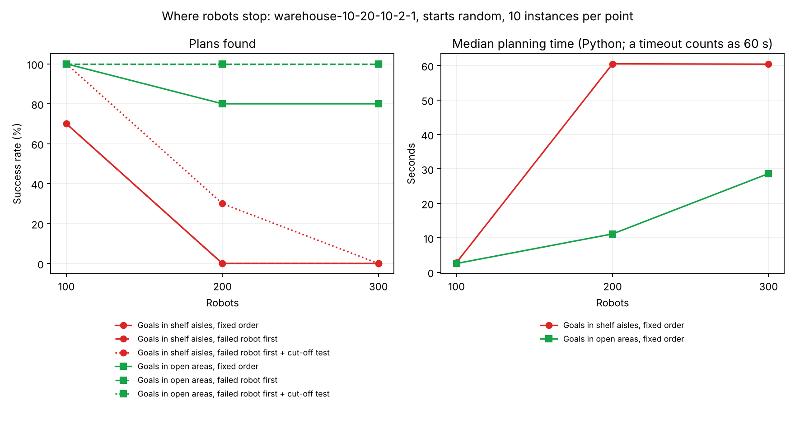
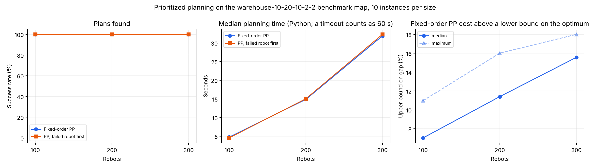
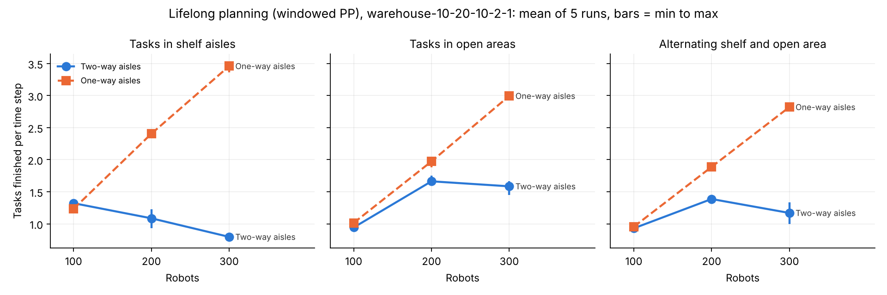

# Scale Experiment: a Standard Warehouse Benchmark Map

The main experiment uses a 12 × 20 map with 137 free cells and at most 20 robots. This folder repeats the prioritized-planning part on a map of realistic size: **`warehouse-10-20-10-2-1`** from the MovingAI MAPF benchmark (Stern et al., 2019), 161 × 63 cells with 5,699 free cells, about 40 times the main map.



## Setup

| Item | Value |
| --- | --- |
| Map | `maps/warehouse-10-20-10-2-1.map` (shelf blocks of 10 × 2 cells, one-cell aisles, open areas left and right) |
| Robots | 50, 100, 150, 200, 250, 300 |
| Instances | 10 per size; starts and goals are distinct random free cells (base seed 20261111) |
| Methods | independent BFS (collisions only), fixed-order PP, PP with the failed robot first |
| Time limit | 60 s per run (Python) |

Endpoints are random free cells, as in the benchmark's "random" scenarios. About half of the free cells (2,649 of 5,699) are in the shelf area with its one-cell aisles; the rest are in the open areas on both sides. A robot parked on a goal in an aisle can block that aisle, as in the main experiment's **aisle** layout.

Joint A* and CBS are not run. At these sizes the optimum cannot be computed, so each PP cost is compared with a **lower bound** on the optimum: the sum of every robot's own shortest-path length. Every robot needs at least that many steps, so optimum ≥ lower bound, and `cost / lower bound − 1` is an **upper bound** on PP's real gap.

## Results

| Robots | Collisions without coordination (median) | Fixed-order PP: plans found | Failed robot first: plans found | Fixed-order PP: median time of successful runs | Fixed-order PP cost above lower bound: median / max |
| ---: | ---: | ---: | ---: | ---: | ---: |
| 50 | 32 | 10/10 | 10/10 | 0.4 s | 3.0% / 5.7% |
| 100 | 127 | 8/10 | 8/10 | 3.3 s | 12.1% / 14.4% |
| 150 | 359 | 10/10 | 10/10 | 6.2 s | 14.1% / 17.4% |
| 200 | 702.5 | 8/10 | 8/10 | 10.4 s | 17.0% / 19.4% |
| 250 | 1,105.5 | 5/10 | 6/10 | 16.5 s | 20.0% / 24.9% |
| 300 | 1,418.5 | 1/10 | 2/10 | 29.1 s | (1 run) |

"Collisions" counts vertex and swap conflicts. Times and costs cover successful runs only; the plot's middle panel instead takes the median over all runs, counting a timeout as 60 s. Where both PP variants succeeded, their costs were identical. Full data: [`results.csv`](results.csv).

1. **Coordination is essential.** Without it, conflicts grow from 32 at 50 robots to over 1,400 at 300.
2. **PP plans hundreds of robots in seconds to tens of seconds**, even in plain Python: 200 robots in about 10 s, 250 in about 16 s (successful runs).
3. **The upper bound on the cost gap grows with crowding.** Its median rises from 3.0% at 50 robots to 20.0% at 250, and the real gap is at most this large. The lower bound ignores robots getting in each other's way, so it probably becomes looser as the floor gets busier; part of the rise may come from the bound rather than from PP.
4. **Timeouts come from robots parked in aisles.** Fixed-order PP failed 18 times: 14 timeouts and 4 `blocked`. In all 14 timeouts, the robot being planned has its goal in the shelf area and is cut off from it once the robots planned before it are parked ([`failure_diagnosis.txt`](failure_diagnosis.txt)), as in the main experiment's aisle layout. A likely reason for the timeout rather than a quick `blocked`: the search horizon is the latest earlier arrival plus 5,699 steps, so the space-time search has a huge number of (cell, time) combinations to rule out first. The 4 `blocked` failures are different: there the robot could still reach its goal around the parked robots, so the cause lies in the earlier robots' moving paths; we did not analyse them further.
5. **Reordering rescued little.** Failed-robot-first rescued 2 of the 18 failures, both `blocked` ones. It cannot help after a timeout: its first attempt is the same as fixed-order PP and uses up the shared 60 s budget. The other 2 `blocked` failures were not rescued either; their second attempt timed out. Follow-up 1 below tests result 4 directly, and follow-up 2 tests result 5.

## Follow-up 1: where robots stop

Result 4 suggests that failures come from robots parked in one-cell aisles. [`run_endpoints.py`](run_endpoints.py) tests this directly on the same map. Starts are random free cells anywhere; only the goals, where robots stop and stay, are restricted:

- **shelf_area:** goals in the shelf area (columns 26 to 134, 2,649 free cells), whose aisles are one cell wide;
- **open_area:** goals in the open areas on the left and right (3,050 free cells);
- **open_matched (control):** goals in a fixed random subset of the open areas with 2,649 cells, as many as the shelf area, so that both goal areas offer the same number of candidate cells (`--matched`).

100, 200 and 300 robots, 10 new instances per size and setting (base seed 20261112), 60 s limit. These are new instance sets, not the instances of the main table, and the shelf and open instances are not paired (their starts differ as well).



| Robots | Goals in | Fixed order | Failed robot first | Failed robot first + cut-off test | Fixed order: median time of successful runs | Fixed order: cost above lower bound, median |
| ---: | --- | ---: | ---: | ---: | ---: | ---: |
| 100 | shelf aisles | 7/10 | 7/10 | 10/10 | 2.2 s | 12.5% |
| 100 | open areas | 10/10 | 10/10 | 10/10 | 2.5 s | 5.0% |
| 200 | shelf aisles | 0/10 | 0/10 | 3/10 | (none) | (none) |
| 200 | open areas | 8/10 | 10/10 | 10/10 | 13.0 s | 14.3% |
| 300 | shelf aisles | 0/10 | 0/10 | 0/10 | (none) | (none) |
| 300 | open areas | 8/10 | 10/10 | 10/10 | 30.3 s | 18.9% |
| 100 | open, 2,649 cells (control) | 10/10 | 10/10 | 10/10 | 3.7 s | 7.3% |
| 200 | open, 2,649 cells (control) | 8/10 | 10/10 | 10/10 | 14.0 s | 13.6% |
| 300 | open, 2,649 cells (control) | 6/10 | 10/10 | 9/10 | 28.8 s | 18.3% |

The cut-off test is the one from follow-up 2 below. In the plot, some lines lie on top of each other (shelf aisles: fixed order and failed robot first; open areas: both failed-robot-first variants). The plot shows the first two settings. Full data: [`endpoints_results.csv`](endpoints_results.csv), [`endpoints_cutoff_shelf.csv`](endpoints_cutoff_shelf.csv), [`endpoints_cutoff_open.csv`](endpoints_cutoff_open.csv), [`endpoints_matched.csv`](endpoints_matched.csv).

- **Where robots stop strongly affects whether PP works at this scale.** With goals in the shelf aisles, fixed-order PP solved none of the 20 instances with 200 or 300 robots; with goals in the open areas it solved 16 of 20 (Fisher exact p = 1.5 × 10⁻⁷), and with the control setting 14 of 20. All 23 shelf-aisle failures were timeouts.
- **This is not because the open-area trips are shorter.** They are longer: per robot, the median shortest path is 86 steps for open-area goals, 91 in the control setting and 71 for shelf-aisle goals (mean 89, 91 and 74).
- **At 200 and 300 robots, reordering does not make up for it.** Without the cut-off test, failed-robot-first changed nothing in the shelf aisles (every failure was a timeout). With the test it rescued all 3 failures at 100 robots, but only 3 of 10 at 200 and none at 300, after 8 to 14 attempts per run. With goals in the open areas, failed-robot-first solved every instance, mostly on the first attempt.
- **Nor because the shelf area has fewer cells.** With the open-area goals restricted to as many cells as the shelf area, fixed-order PP still solved 14 of 20 instances at 200 and 300 robots, and failed-robot-first solved all 20.
- **Remaining differences:** the two goal areas also differ in where they lie on the map (sides vs middle), so this is still a comparison of two areas, not of aisle width alone. The shelf and open runs were made in parallel on a 2-core machine; the control run was made on its own.

## Follow-up 2: detect failure early, then reorder

Result 5 left open whether reordering fails at scale because of the method or because the failed attempt used up the time. [`run_cutoff.py`](run_cutoff.py) re-plans the same 60 instances with one extra test before each robot's search: if the robot cannot reach its goal when the robots planned before it are treated as walls at their goals, it is reported as `cut_off` at once (`fast_pp.cut_off`). The test is conservative: it ignores that a robot may get through before an earlier robot has parked, so it can report `cut_off` for a robot that could still be planned.

| Robots | Fixed order | Fixed order + test | Test fired | Failed robot first | Failed robot first + test | Median time without / with test, instances both solved |
| ---: | ---: | ---: | ---: | ---: | ---: | ---: |
| 50 | 10/10 | 10/10 | 0 | 10/10 | 10/10 | 0.4 s / 0.5 s |
| 100 | 8/10 | 7/10 | 3 | 8/10 | 10/10 | 3.5 s / 3.4 s |
| 150 | 10/10 | 5/10 | 5 | 10/10 | 10/10 | 6.3 s / 7.6 s |
| 200 | 8/10 | 3/10 | 7 | 8/10 | 10/10 | 10.6 s / 15.4 s |
| 250 | 5/10 | 2/10 | 8 | 6/10 | 8/10 | 16.2 s / 31.2 s |
| 300 | 1/10 | 0/10 | 9 | 2/10 | 1/10 | 31.4 s / 34.3 s (1 instance) |
| **All** | **42/60** | **27/60** | **32** | **44/60** | **49/60** | |

"Test fired" counts runs of fixed order + test that stopped with `cut_off`. Times are for the failed-robot-first variants, taken only over instances both of them solved, so the two medians cover the same instances. Full data: [`cutoff_results.csv`](cutoff_results.csv), compared with `pp` and `pp_promote` in [`results.csv`](results.csv).

- **The test catches the timeouts.** It fired in 17 of the 18 runs that fixed-order PP failed, including all 14 timeouts, after 1.5 to 10.0 s, where the timeouts had used the full 60 s.
- **It also fires too often.** On the 42 instances that fixed-order PP solved, it reported `cut_off` on 15 (36%). On those instances the order changes for no reason.
- **Net effect: 44 → 49 of 60.** With the test, failed-robot-first solved 7 instances it could not solve before (all of them timeouts, 100 to 250 robots) and lost 2 it had solved (250 and 300 robots), where the extra reorders ran out of time after 4 attempts. At 300 robots it solved 1 of 10 instead of 2. With 7 gained and 2 lost, this net gain alone is not statistically significant (McNemar exact p = 0.18); the extra instances below settle it.
- **Cost is about the same.** Where both variants succeeded, 15 instances ended with a different order; in 14 of them the cost changed, by less than 1 percentage point of the lower bound (10 lower, 4 higher).
- **It costs time.** On instances both variants solved, the median time rose from 10.6 to 15.4 s at 200 robots and from 16.2 to 31.2 s at 250. Most of this comes from the extra reorders; where the test never fired, runs were about 5–8% slower (one extra search per robot).

- **More instances: the gain is real from 100 to 250 robots.** [`extra_runs.py cutoff`](extra_runs.py) adds 20 new random-endpoint instances per size for 100, 150, 200 and 250 robots. On these 80, failed-robot-first solved 63 without the test and 79 with it (16 gained, 0 lost, McNemar exact p = 3 × 10⁻⁵). Over all 30 instances per size it is 95 → 117 of 120 (23 gained, 1 lost, p = 3 × 10⁻⁶). At 300 robots, run only on the original 10, the test did not help (2 → 1). These extra runs were made while other experiments used the second core; several finished close to the 60 s limit. Full data: [`extra_cutoff.csv`](extra_cutoff.csv).

So reordering can help at scale once failure is detected quickly: from 100 to 250 robots the cut-off test turns most timeouts into successes, at the cost of false alarms and longer planning. The table comes from a run on its own. A first run, made in parallel with follow-up 1 on the same 2-core machine, gave exactly the same statuses and costs; times differed by up to 15% (median under 1%).

## Second map: two-cell aisles

To check that the results are not specific to one map, [`run_scale.py --map`](run_scale.py) repeats the main table on **`warehouse-10-20-10-2-2`** from the same benchmark: the same shelf blocks, but every aisle is two cells wide (170 × 84 cells, 9,776 free cells). Random starts and goals, 100, 200 and 300 robots, 10 instances per size, 60 s limit, run on its own. Results: [`warehouse-10-20-10-2-2/`](warehouse-10-20-10-2-2/).



| Robots | Collisions without coordination (median) | Fixed-order PP: plans found | Same on the one-cell-aisle map | Fixed-order PP: median time of successful runs | Cost above lower bound: median / max |
| ---: | ---: | ---: | ---: | ---: | ---: |
| 100 | 88 | 10/10 | 8/10 | 4.8 s | 7.0% / 11.0% |
| 200 | 402 | 10/10 | 8/10 | 14.9 s | 11.4% / 16.0% |
| 300 | 886 | 10/10 | 1/10 | 31.9 s | 15.6% / 18.0% |

- **The same pattern holds on a second map:** coordination is essential (hundreds of collisions without it), PP plans hundreds of robots in seconds to tens of seconds, and the upper bound on its cost gap grows with crowding (7.0% → 15.6%).
- **With two-cell aisles PP never failed** (30 of 30), where the one-cell-aisle map gave 17 of 30 at the same robot counts, plausibly because a parked robot in a two-cell aisle leaves room to pass.
- **Crowding is not the explanation.** This map is larger (9,776 free cells against 5,699), so the same number of robots is less crowded. [`extra_runs.py density`](extra_runs.py) therefore repeats both maps at the same robots per free cell: 100, 200, 300 robots on the one-cell-aisle map (the instances above) and 172, 343, 515 robots here, with a 120 s limit on both because the larger plans take longer in Python.

| Robots per free cell | One-cell aisles: robots, plans found | Two-cell aisles: robots, plans found |
| ---: | ---: | ---: |
| 1.75% | 100: 8/10 | 172: 10/10 |
| 3.5% | 200: 8/10 | 343: 10/10 |
| 5.3% | 300: 1/10 | 515: 8/10 |

  At equal crowding PP solved 28 of 30 instances with two-cell aisles against 17 of 30 with one-cell aisles (Fisher exact p = 0.002). The doubled time limit did not change any one-cell result. The maps still differ in size and layout details, so this is strong evidence for aisle width, not a controlled experiment on width alone. Full data: [`extra_density.csv`](extra_density.csv).

## Follow-up 3: a newer fast planner (LaCAM)

Is the layout effect specific to prioritized planning? [`lacam.py`](lacam.py) implements LaCAM (Okumura, AAAI 2023) from the paper in Python: PIBT moves all robots one step at a time, and a search over configurations backs up when PIBT gets stuck. Unlike PP, LaCAM is complete: given enough time it finds a plan whenever one exists. This is our own implementation of the basic algorithm, not the authors' optimized C++ code and not LaCAM*, which keeps improving the cost; one detail follows the authors' code rather than the AAAI pseudocode (a configuration reached again is revisited instead of skipped). [`run_lacam.py`](run_lacam.py) runs it on the same instances as PP, 60 s limit, plans re-checked with `check_plan`.

| Instances | Robots | LaCAM: plans found | PP: plans found | Median time, LaCAM / PP (successful runs) | Cost above lower bound, median: LaCAM / PP |
| --- | ---: | ---: | ---: | ---: | ---: |
| Random endpoints | 50 | 10/10 | 10/10 | 0.1 s / 0.4 s | 12.4% / 3.0% |
| Random endpoints | 100 | 10/10 | 8/10 | 0.9 s / 3.3 s | 33.7% / 12.1% |
| Random endpoints | 150 | 10/10 | 10/10 | 12.6 s / 6.2 s | 54.2% / 14.1% |
| Random endpoints | 200 | 4/10 | 8/10 | 18.5 s / 10.4 s | 59.1% / 17.0% |
| Random endpoints | 250 | 1/10 | 5/10 | 54.9 s / 16.5 s | (1 run) / 20.0% |
| Random endpoints | 300 | 1/10 | 1/10 | (1 run each) | (1 run each) |
| Goals in shelf aisles | 100 | 6/10 | 7/10 | 9.4 s / 2.2 s | 81.4% / 12.5% |
| Goals in shelf aisles | 200 and 300 | 0/20 | 0/20 | | |
| Goals in open areas | 100 | 10/10 | 10/10 | 0.3 s / 2.5 s | 20.4% / 5.0% |
| Goals in open areas | 200 | 10/10 | 8/10 | 0.6 s / 13.0 s | 45.8% / 14.3% |
| Goals in open areas | 300 | 10/10 | 8/10 | 0.9 s / 30.3 s | 59.4% / 18.9% |

PP columns repeat `results.csv` and `endpoints_results.csv`. Full data: [`lacam_scale.csv`](lacam_scale.csv), [`lacam_endpoints.csv`](lacam_endpoints.csv).

- **The layout effect is not specific to PP.** With goals in the shelf aisles LaCAM also solved none of the 20 instances with 200 and 300 robots; with goals in the open areas it solved all 20 (Fisher exact p = 1.5 × 10⁻¹¹).
- **Where robots stop in the open, LaCAM is much faster than PP** (under 1 s against 2.5–30 s) and never failed, **but its plans cost three to four times as much above the lower bound** (medians over each method's successful runs).
- **With random endpoints our LaCAM did worse than PP at 200 and 250 robots**, timing out on most instances. On the 12 × 20 map one of two variants (revisiting or skipping configurations seen before) found a valid plan for every one of the 400 instances, so every instance there has a plan ([`../analysis/lacam_small.txt`](../analysis/lacam_small.txt)).
- **Limit:** the LaCAM paper reports success, speed and cost competitive with other fast planners; our Python version of the basic algorithm, without the authors' engineering, is not a fair test of LaCAM's best performance. What it does show is that the shelf-aisle failures are not just a weakness of planning one robot at a time.

## Follow-up 4: one-way aisles

Amazon describes "social rules" such as virtual streets with a fixed direction. [`oneway.py`](oneway.py) adds such rules to the shelf area: horizontal aisles alternate east- and westbound, vertical aisles between shelf blocks alternate south- and northbound, and the open areas stay two-way (the map stays strongly connected). PP itself is unchanged; it plans on the restricted graph. 60 s limit; cost is compared with the same two-way lower bound, so it includes detours forced by the rules.

| Instances | Robots | One-way: plans found | Two-way: plans found | Cost above lower bound, median (both solved): one-way / two-way |
| --- | ---: | ---: | ---: | ---: |
| Random endpoints | 200, 250, 300 | 0/30 | 14/30 | |
| Goals in shelf aisles | 200, 300 | 0/20 | 0/20 | |
| Goals in open areas | 200 | 10/10 | 8/10 | 17.9% / 14.3% |
| Goals in open areas | 300 | 10/10 | 8/10 | 22.3% / 18.9% |

Full data: [`oneway_results.csv`](oneway_results.csv), [`oneway_open.csv`](oneway_open.csv).

- **With random endpoints or goals in the shelf aisles, one-way rules made PP fail completely**: 14 of 50 solved two-way (all 14 with random endpoints), 0 of 50 one-way (McNemar exact p = 0.00012). A likely reason: a robot parked in a one-way aisle closes it for everyone behind it; with the cut-off test, a cut-off robot appeared within a second on each of the four random-endpoint instances checked ([`oneway_diagnosis.txt`](oneway_diagnosis.txt)).
- **When robots stop in the open areas, one-way rules did not hurt**: PP solved all 20 instances (two-way: 16), with median times on instances solved both ways of 9.9 s against 13.0 s at 200 robots and 23.7 s against 30.3 s at 300. The gain in success is not statistically significant (4 gained, 0 lost, p = 0.12), and the plans cost a few points more because of detours.
- So in our model this traffic rule worked only when robots stopped outside the aisles. This matches the idea of virtual streets plus separate stations, but we did not model real stations or continuous tasks.

These runs and follow-up 3 ran at the same time on a 2-core machine. A few successes finished close to the 60 s limit (for example LaCAM's single successes at 250 and 300 robots, at 55 and 56 s), so counts near the limit may depend on machine load.

## Follow-up 5: lifelong planning (tasks keep arriving)

All runs above plan one batch: each robot gets one goal and stays there, so a robot that stops in an aisle blocks it for good. Real warehouses never stop. [`lifelong.py`](lifelong.py) simulates that: when a robot reaches its goal it gets the next task at once. Planning follows rolling-horizon collision resolution (RHCR, Li et al., AAAI 2021, written with Amazon Robotics researchers) in a simplified form, close to its variant with prioritized planning inside the window (CA*): every 5 steps all robots are replanned with PP, and paths only have to avoid each other for the next 10 steps. A robot that cannot be planned waits in place for that window, so one stuck robot never stops the others. Every executed step is checked (legal move, no shared cell, no swap). 500 steps per run, 5 runs per setting, random start cells.



| Tasks | Robots | Throughput (tasks per step), two-way / one-way | Efficiency, two-way / one-way | Robots that never finished a task (worst run), two-way / one-way |
| --- | ---: | ---: | ---: | ---: |
| In shelf aisles | 100 | 1.32 / 1.23 | 0.76 / 0.71 | 0 / 0 |
| In shelf aisles | 200 | 1.09 / 2.40 | 0.31 / 0.69 | 38 / 0 |
| In shelf aisles | 300 | 0.80 / 3.46 | 0.15 / 0.67 | 114 / 0 |
| In open areas | 100 | 0.94 / 1.01 | 0.75 / 0.82 | 0 / 0 |
| In open areas | 200 | 1.66 / 1.97 | 0.67 / 0.82 | 0 / 0 |
| In open areas | 300 | 1.58 / 2.99 | 0.37 / 0.82 | 41 / 0 |
| Alternating shelf and open area | 100 | 0.93 / 0.95 | 0.78 / 0.80 | 0 / 0 |
| Alternating shelf and open area | 200 | 1.39 / 1.89 | 0.57 / 0.79 | 8 / 0 |
| Alternating shelf and open area | 300 | 1.17 / 2.82 | 0.29 / 0.78 | 85 / 0 |

Throughput and efficiency are means of 5 runs. *Efficiency* is the summed shortest-path length (on the two-way map) of all finished tasks divided by robots × steps: the share of robot time that turned into useful progress, independent of how long the tasks are. "Alternating" sends each robot alternately to a shelf-area cell and an open-area cell, like fetching a shelf and bringing it to a station. Full data: [`lifelong_results.csv`](lifelong_results.csv); tests in [`../analysis/significance.txt`](../analysis/significance.txt).

- **With two-way aisles, adding robots beyond 200 lowers throughput.** In every task setting, 300 robots finished fewer tasks per step than 200 (shelf: 1.09 → 0.80), and in the worst run 41 to 114 robots never finished a task. The most likely cause: robots meeting head-on in one-cell aisles block each other, and planning only 10 steps ahead cannot resolve it (we did not trace individual blockages).
- **One-way aisles reverse this.** With the same tasks and robots, throughput keeps rising with the number of robots (shelf: 1.23 → 2.40 → 3.46), efficiency stays between 0.67 and 0.82, and every robot finished tasks. At 200 and 300 robots, in each of the six settings every one-way run had a higher throughput than every two-way run (Mann-Whitney exact p = 0.008, the smallest possible with 5 runs each).
- **At 100 robots the difference is small:** one-way cost a little with tasks in the shelf area (1.32 against 1.23, p = 0.008), where one-way routes are longer and there is little congestion to avoid, and helped a little with tasks in the open areas (0.94 against 1.01).
- **This reverses the one-shot result of follow-up 4**, where one-way rules made PP fail. In the one-shot model a parked robot closes a one-way aisle forever; in lifelong operation robots leave their goals, and the main problem becomes robots meeting head-on, which one-way rules prevent.
- **Context:** the RHCR paper itself uses a directed (one-way) version of its sorting-centre map, so that the planners do not have to resolve robots swapping places.
- **Limits:** this is a simplified RHCR: PP only, not the stronger windowed planners RHCR also uses (PBS, ECBS), no reservations beyond the window, a goal counts only when the robot stands on it at a replanning (every 5 steps), one map. A stronger windowed planner might handle two-way aisles better, so the size of the gap is specific to our planner; the direction matches the traffic rules that Amazon describes.

## How the speed-up was checked

`mapf.py` checks every earlier robot's path for every candidate move. That is too slow at this size: with 50 robots `mapf.py` took 1.7 to 9.3 s per run where `fast_pp.py` took 0.3 to 1.3 s ([`equivalence_check.txt`](equivalence_check.txt)), and in a trial run (not saved) 200 robots did not finish within 2 minutes. [`fast_pp.py`](fast_pp.py) implements the same algorithm with the same neighbour order, tie-breaking, horizon and reordering rules, but keeps the reservations in hash tables. [`check_equivalence.py`](check_equivalence.py) confirms that both return identical paths and statuses:

- all 1,200 PP runs of the main experiment (400 instances × 3 PP methods), against the saved `outputs/plans.jsonl`;
- 12 runs on this map with 25 and 50 robots (own random instances), run side by side with `mapf.py`.

Output of the run: [`equivalence_check.txt`](equivalence_check.txt).

Plans in this folder are checked with `check_plan` in `run_scale.py`, which gave the same result as `verification/check_results.py`'s validator on 12 test plans (including colliding ones).

## Limits

- **Python runtimes.** Production planners are compiled and heavily optimized; the times show the trend, not achievable speed.
- **10 instances per size.** Success rates move in steps of 10 percentage points; the dip at 100 robots (8/10) next to 150 (10/10) is within that noise.
- **Random endpoints.** The benchmark map has no recessed bays, so this does not repeat the main experiment's warehouse layout.
- **One-shot planning in most runs.** Except for follow-up 5, robots plan one batch and stay on their goals; follow-up 5 simulates continuous tasks with a simplified planner.
- **Two maps from one benchmark family.** Both maps are synthetic MovingAI warehouses with random endpoints; real fulfilment centres differ in layout and in where tasks start and end.
- **Newer fast planners only in a basic form.** LaCAM was run as our own Python implementation of the basic algorithm (follow-up 3); the authors' optimized code, LaCAM* and windowed planning (RHCR) were not run.
- **Map source.** The benchmark site was not reachable from the environment used, so the map was copied from the `lacam3` repository ([github.com/kei18/lacam3](https://github.com/kei18/lacam3), commit `1c3ecf8`, `scripts/map/`). The original is at [movingai.com/benchmarks/mapf](https://movingai.com/benchmarks/mapf/index.html).

## How to run

From the repository root:

```bash
python scale/check_equivalence.py   # fast_pp.py vs mapf.py (several minutes)
python scale/run_scale.py           # full experiment (about 1 hour)
python scale/run_scale.py --quick   # small check (seconds)
python scale/diagnose_failures.py   # why the failed runs failed (about 15 minutes)
python scale/run_endpoints.py       # follow-up 1: goals in shelf aisles vs open areas (about 40 minutes)
python scale/run_endpoints.py --cutoff shelf_area   # follow-up 1, cut-off variant (also open_area)
python scale/run_cutoff.py          # follow-up 2: cut-off test (about 40 minutes)
python scale/run_scale.py --map warehouse-10-20-10-2-2   # second map (about 25 minutes)
python scale/run_lacam.py scale     # follow-up 3: LaCAM, random endpoints (about 30 minutes)
python scale/run_lacam.py endpoints # follow-up 3: LaCAM, goal areas (about 30 minutes)
python scale/oneway.py              # follow-up 4: one-way aisles (about 50 minutes; then: oneway.py open)
python scale/lifelong.py            # follow-up 5: lifelong planning (about 25 minutes)
```

## Reference

Stern, R. et al. (2019). *Multi-Agent Pathfinding: Definitions, Variants, and Benchmarks.* Symposium on Combinatorial Search (SoCS).

The code in this folder was written with the help of Claude (AI assistant).
