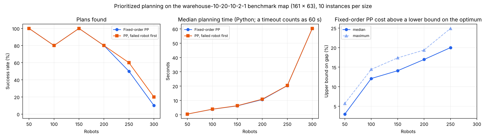
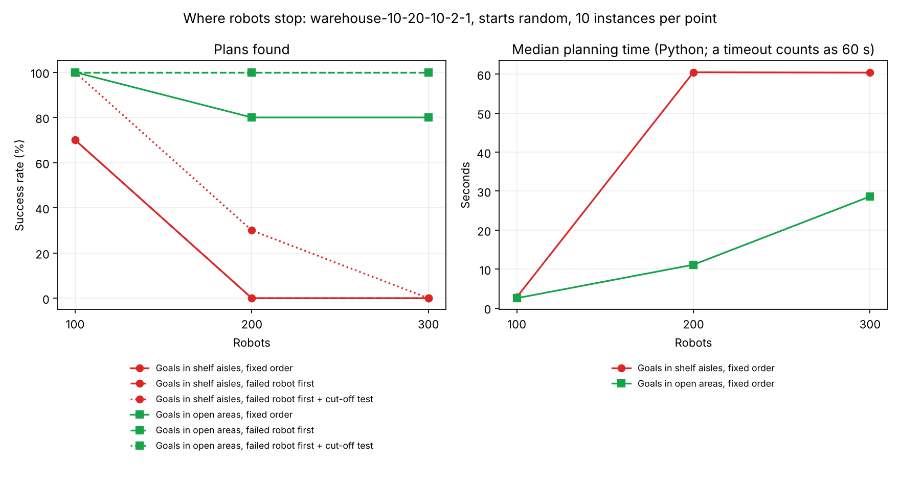
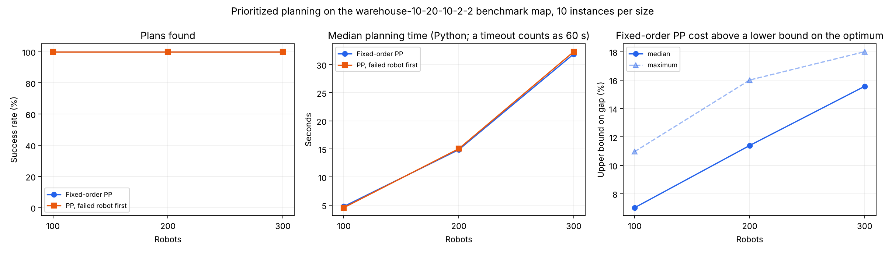

# Scale Experiment: a Standard Warehouse Benchmark Map

The main experiment uses a 12 × 20 map with 137 free cells and at most 20 robots. This folder repeats the prioritized-planning part on a map of realistic size: **`warehouse-10-20-10-2-1`** from the MovingAI MAPF benchmark (Stern et al., 2019), 161 × 63 cells with 5,699 free cells, about 40 times the main map.



## Setup

| Item | Value |
| --- | --- |
| Map | `maps/warehouse-10-20-10-2-1.map` (shelf blocks of 10 × 2 cells, one-cell aisles, open areas left and right) |
| Robots | 50, 100, 150, 200, 250, 300 |
| Instances | 10 per size; starts and goals are distinct random free cells (base seed 20261111) |
| Methods | independent BFS (collisions only), fixed-order PP, PP with the failed robot first |
| Time limit | 60 s per run (Python) |

Endpoints are random free cells, as in the benchmark's "random" scenarios. About half of the free cells (2,649 of 5,699) are in the shelf area with its one-cell aisles; the rest are in the open areas on both sides. A robot parked on a goal in an aisle can block that aisle, as in the main experiment's **aisle** layout.

Joint A* and CBS are not run. At these sizes the optimum cannot be computed, so each PP cost is compared with a **lower bound** on the optimum: the sum of every robot's own shortest-path length. Every robot needs at least that many steps, so optimum ≥ lower bound, and `cost / lower bound − 1` is an **upper bound** on PP's real gap.

## Results

| Robots | Collisions without coordination (median) | Fixed-order PP: plans found | Failed robot first: plans found | Fixed-order PP: median time of successful runs | Fixed-order PP cost above lower bound: median / max |
| ---: | ---: | ---: | ---: | ---: | ---: |
| 50 | 32 | 10/10 | 10/10 | 0.4 s | 3.0% / 5.7% |
| 100 | 127 | 8/10 | 8/10 | 3.3 s | 12.1% / 14.4% |
| 150 | 359 | 10/10 | 10/10 | 6.2 s | 14.1% / 17.4% |
| 200 | 702.5 | 8/10 | 8/10 | 10.4 s | 17.0% / 19.4% |
| 250 | 1,105.5 | 5/10 | 6/10 | 16.5 s | 20.0% / 24.9% |
| 300 | 1,418.5 | 1/10 | 2/10 | 29.1 s | (1 run) |

"Collisions" counts vertex and swap conflicts. Times and costs cover successful runs only; the plot's middle panel instead takes the median over all runs, counting a timeout as 60 s. Where both PP variants succeeded, their costs were identical. Full data: [`results.csv`](results.csv).

1. **Coordination is essential.** Without it, conflicts grow from 32 at 50 robots to over 1,400 at 300.
2. **PP plans hundreds of robots in seconds to tens of seconds**, even in plain Python: 200 robots in about 10 s, 250 in about 16 s (successful runs).
3. **The upper bound on the cost gap grows with crowding.** Its median rises from 3.0% at 50 robots to 20.0% at 250, and the real gap is at most this large. The lower bound ignores robots getting in each other's way, so it probably becomes looser as the floor gets busier; part of the rise may come from the bound rather than from PP.
4. **Timeouts come from robots parked in aisles.** Fixed-order PP failed 18 times: 14 timeouts and 4 `blocked`. In all 14 timeouts, the robot being planned has its goal in the shelf area and is cut off from it once the robots planned before it are parked ([`failure_diagnosis.txt`](failure_diagnosis.txt)), as in the main experiment's aisle layout. A likely reason for the timeout rather than a quick `blocked`: the search horizon is the latest earlier arrival plus 5,699 steps, so the space-time search has a huge number of (cell, time) combinations to rule out first. The 4 `blocked` failures are different: there the robot could still reach its goal around the parked robots, so the cause lies in the earlier robots' moving paths; we did not analyse them further.
5. **Reordering rescued little.** Failed-robot-first rescued 2 of the 18 failures, both `blocked` ones. It cannot help after a timeout: its first attempt is the same as fixed-order PP and uses up the shared 60 s budget. The other 2 `blocked` failures were not rescued either; their second attempt timed out. Follow-up 1 below tests result 4 directly, and follow-up 2 tests result 5.

## Follow-up 1: where robots stop

Result 4 suggests that failures come from robots parked in one-cell aisles. [`run_endpoints.py`](run_endpoints.py) tests this directly on the same map. Starts are random free cells anywhere; only the goals, where robots stop and stay, are restricted:

- **shelf_area:** goals in the shelf area (columns 26 to 134, 2,649 free cells), whose aisles are one cell wide;
- **open_area:** goals in the open areas on the left and right (3,050 free cells);
- **open_matched (control):** goals in a fixed random subset of the open areas with 2,649 cells, as many as the shelf area, so that both goal areas offer the same number of candidate cells (`--matched`).

100, 200 and 300 robots, 10 new instances per size and setting (base seed 20261112), 60 s limit. These are new instance sets, not the instances of the main table, and the shelf and open instances are not paired (their starts differ as well).



| Robots | Goals in | Fixed order | Failed robot first | Failed robot first + cut-off test | Fixed order: median time of successful runs | Fixed order: cost above lower bound, median |
| ---: | --- | ---: | ---: | ---: | ---: | ---: |
| 100 | shelf aisles | 7/10 | 7/10 | 10/10 | 2.2 s | 12.5% |
| 100 | open areas | 10/10 | 10/10 | 10/10 | 2.5 s | 5.0% |
| 200 | shelf aisles | 0/10 | 0/10 | 3/10 | (none) | (none) |
| 200 | open areas | 8/10 | 10/10 | 10/10 | 13.0 s | 14.3% |
| 300 | shelf aisles | 0/10 | 0/10 | 0/10 | (none) | (none) |
| 300 | open areas | 8/10 | 10/10 | 10/10 | 30.3 s | 18.9% |
| 100 | open, 2,649 cells (control) | 10/10 | 10/10 | 10/10 | 3.7 s | 7.3% |
| 200 | open, 2,649 cells (control) | 8/10 | 10/10 | 10/10 | 14.0 s | 13.6% |
| 300 | open, 2,649 cells (control) | 6/10 | 10/10 | 9/10 | 28.8 s | 18.3% |

The cut-off test is the one from follow-up 2 below. In the plot, some lines lie on top of each other (shelf aisles: fixed order and failed robot first; open areas: both failed-robot-first variants). The plot shows the first two settings. Full data: [`endpoints_results.csv`](endpoints_results.csv), [`endpoints_cutoff_shelf.csv`](endpoints_cutoff_shelf.csv), [`endpoints_cutoff_open.csv`](endpoints_cutoff_open.csv), [`endpoints_matched.csv`](endpoints_matched.csv).

- **Where robots stop strongly affects whether PP works at this scale.** With goals in the shelf aisles, fixed-order PP solved none of the 20 instances with 200 or 300 robots; with goals in the open areas it solved 16 of 20 (Fisher exact p = 1.5 × 10⁻⁷), and with the control setting 14 of 20. All 23 shelf-aisle failures were timeouts.
- **This is not because the open-area trips are shorter.** They are longer: per robot, the median shortest path is 86 steps for open-area goals, 91 in the control setting and 71 for shelf-aisle goals (mean 89, 91 and 74).
- **At 200 and 300 robots, reordering does not make up for it.** Without the cut-off test, failed-robot-first changed nothing in the shelf aisles (every failure was a timeout). With the test it rescued all 3 failures at 100 robots, but only 3 of 10 at 200 and none at 300, after 8 to 14 attempts per run. With goals in the open areas, failed-robot-first solved every instance, mostly on the first attempt.
- **Nor because the shelf area has fewer cells.** With the open-area goals restricted to as many cells as the shelf area, fixed-order PP still solved 14 of 20 instances at 200 and 300 robots, and failed-robot-first solved all 20.
- **Remaining differences:** the two goal areas also differ in where they lie on the map (sides vs middle), so this is still a comparison of two areas, not of aisle width alone. The shelf and open runs were made in parallel on a 2-core machine; the control run was made on its own.

## Follow-up 2: detect failure early, then reorder

Result 5 left open whether reordering fails at scale because of the method or because the failed attempt used up the time. [`run_cutoff.py`](run_cutoff.py) re-plans the same 60 instances with one extra test before each robot's search: if the robot cannot reach its goal when the robots planned before it are treated as walls at their goals, it is reported as `cut_off` at once (`fast_pp.cut_off`). The test is conservative: it ignores that a robot may get through before an earlier robot has parked, so it can report `cut_off` for a robot that could still be planned.

| Robots | Fixed order | Fixed order + test | Test fired | Failed robot first | Failed robot first + test | Median time without / with test, instances both solved |
| ---: | ---: | ---: | ---: | ---: | ---: | ---: |
| 50 | 10/10 | 10/10 | 0 | 10/10 | 10/10 | 0.4 s / 0.5 s |
| 100 | 8/10 | 7/10 | 3 | 8/10 | 10/10 | 3.5 s / 3.4 s |
| 150 | 10/10 | 5/10 | 5 | 10/10 | 10/10 | 6.3 s / 7.6 s |
| 200 | 8/10 | 3/10 | 7 | 8/10 | 10/10 | 10.6 s / 15.4 s |
| 250 | 5/10 | 2/10 | 8 | 6/10 | 8/10 | 16.2 s / 31.2 s |
| 300 | 1/10 | 0/10 | 9 | 2/10 | 1/10 | 31.4 s / 34.3 s (1 instance) |
| **All** | **42/60** | **27/60** | **32** | **44/60** | **49/60** | |

"Test fired" counts runs of fixed order + test that stopped with `cut_off`. Times are for the failed-robot-first variants, taken only over instances both of them solved, so the two medians cover the same instances. Full data: [`cutoff_results.csv`](cutoff_results.csv), compared with `pp` and `pp_promote` in [`results.csv`](results.csv).

- **The test catches the timeouts.** It fired in 17 of the 18 runs that fixed-order PP failed, including all 14 timeouts, after 1.5 to 10.0 s, where the timeouts had used the full 60 s.
- **It also fires too often.** On the 42 instances that fixed-order PP solved, it reported `cut_off` on 15 (36%). On those instances the order changes for no reason.
- **Net effect: 44 → 49 of 60.** With the test, failed-robot-first solved 7 instances it could not solve before (all of them timeouts, 100 to 250 robots) and lost 2 it had solved (250 and 300 robots), where the extra reorders ran out of time after 4 attempts. At 300 robots it solved 1 of 10 instead of 2. With 7 gained and 2 lost, the net gain is **not statistically significant** (McNemar exact p = 0.18; see [`../analysis/significance.txt`](../analysis/significance.txt)), so it shows a tendency, not an established improvement.
- **Cost is about the same.** Where both variants succeeded, 15 instances ended with a different order; in 14 of them the cost changed, by less than 1 percentage point of the lower bound (10 lower, 4 higher).
- **It costs time.** On instances both variants solved, the median time rose from 10.6 to 15.4 s at 200 robots and from 16.2 to 31.2 s at 250. Most of this comes from the extra reorders; where the test never fired, runs were about 5% slower (one extra search per robot).

So reordering can help at scale only once failure is detected quickly, and this simple test trades false alarms for speed; on 60 instances the overall gain is within chance. The table comes from a run on its own. A first run, made in parallel with follow-up 1 on the same 2-core machine, gave exactly the same statuses and costs, with times within a few percent.

## Second map: two-cell aisles

To check that the results are not specific to one map, [`run_scale.py --map`](run_scale.py) repeats the main table on **`warehouse-10-20-10-2-2`** from the same benchmark: the same shelf blocks, but every aisle is two cells wide (170 × 84 cells, 9,776 free cells). Random starts and goals, 100, 200 and 300 robots, 10 instances per size, 60 s limit, run on its own. Results: [`warehouse-10-20-10-2-2/`](warehouse-10-20-10-2-2/).



| Robots | Collisions without coordination (median) | Fixed-order PP: plans found | Same on the one-cell-aisle map | Fixed-order PP: median time of successful runs | Cost above lower bound: median / max |
| ---: | ---: | ---: | ---: | ---: | ---: |
| 100 | 88 | 10/10 | 8/10 | 4.8 s | 7.0% / 11.0% |
| 200 | 402 | 10/10 | 8/10 | 14.9 s | 11.4% / 16.0% |
| 300 | 886 | 10/10 | 1/10 | 31.9 s | 15.6% / 18.0% |

- **The same pattern holds on a second map:** coordination is essential (hundreds of collisions without it), PP plans hundreds of robots in seconds to tens of seconds, and the upper bound on its cost gap grows with crowding (7.0% → 15.6%).
- **With two-cell aisles PP never failed** (30 of 30), where the one-cell-aisle map gave 17 of 30 at the same robot counts. A parked robot in a two-cell aisle leaves room to pass.
- **Limit:** this map is also larger (9,776 free cells against 5,699), so the same number of robots is less crowded: 300 robots here are about as dense as 175 on the first map, where PP solved 10 of 10 at 150 and 8 of 10 at 200. The comparison therefore does not isolate aisle width; it shows that the findings carry over to a second benchmark warehouse.

## How the speed-up was checked

`mapf.py` checks every earlier robot's path for every candidate move. That is too slow at this size: with 50 robots `mapf.py` took 1.7 to 9.3 s per run where `fast_pp.py` took 0.3 to 1.3 s ([`equivalence_check.txt`](equivalence_check.txt)), and in a trial run (not saved) 200 robots did not finish within 2 minutes. [`fast_pp.py`](fast_pp.py) implements the same algorithm with the same neighbour order, tie-breaking, horizon and reordering rules, but keeps the reservations in hash tables. [`check_equivalence.py`](check_equivalence.py) confirms that both return identical paths and statuses:

- all 1,200 PP runs of the main experiment (400 instances × 3 PP methods), against the saved `outputs/plans.jsonl`;
- 12 runs on this map with 25 and 50 robots (own random instances), run side by side with `mapf.py`.

Output of the run: [`equivalence_check.txt`](equivalence_check.txt).

Plans in this folder are checked with `check_plan` in `run_scale.py`, which gave the same result as `verification/check_results.py`'s validator on 12 test plans (including colliding ones).

## Limits

- **Python runtimes.** Production planners are compiled and heavily optimized; the times show the trend, not achievable speed.
- **10 instances per size.** Success rates move in steps of 10 percentage points; the dip at 100 robots (8/10) next to 150 (10/10) is within that noise.
- **Random endpoints.** The benchmark map has no recessed bays, so this does not repeat the main experiment's warehouse layout.
- **One-shot planning.** Real warehouses assign new tasks continuously (lifelong MAPF); this experiment plans one batch, and finished robots stay on their goals.
- **Two maps from one benchmark family.** Both maps are synthetic MovingAI warehouses with random endpoints; real fulfilment centres differ in layout and in where tasks start and end.
- **No comparison with newer fast planners** such as LaCAM, PIBT or windowed planning (RHCR). They were not run here, so the results describe prioritized planning, not the best available fast planner.
- **Map source.** The benchmark site was not reachable from the environment used, so the map was copied from the `lacam3` repository ([github.com/kei18/lacam3](https://github.com/kei18/lacam3), commit `1c3ecf8`, `scripts/map/`). The original is at [movingai.com/benchmarks/mapf](https://movingai.com/benchmarks/mapf/index.html).

## How to run

From the repository root:

```bash
python scale/check_equivalence.py   # fast_pp.py vs mapf.py (several minutes)
python scale/run_scale.py           # full experiment (about 1 hour)
python scale/run_scale.py --quick   # small check (seconds)
python scale/diagnose_failures.py   # why the failed runs failed (about 15 minutes)
python scale/run_endpoints.py       # follow-up 1: goals in shelf aisles vs open areas (about 40 minutes)
python scale/run_endpoints.py --cutoff shelf_area   # follow-up 1, cut-off variant (also open_area)
python scale/run_cutoff.py          # follow-up 2: cut-off test (about 40 minutes)
python scale/run_scale.py --map warehouse-10-20-10-2-2   # second map (about 25 minutes)
```

## Reference

Stern, R. et al. (2019). *Multi-Agent Pathfinding: Definitions, Variants, and Benchmarks.* Symposium on Combinatorial Search (SoCS).

The code in this folder was written with the help of Claude (AI assistant).
